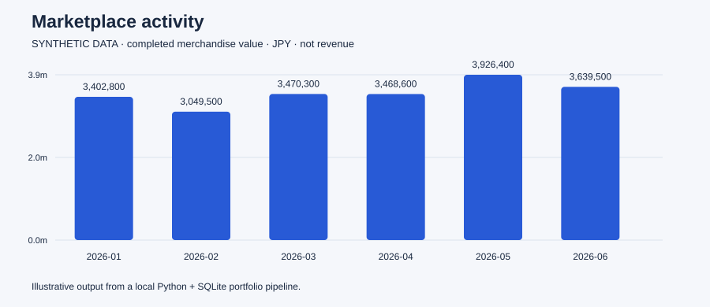

# Marketplace Data Pipeline

**A small Python + SQL portfolio learning project. Synthetic data only.**

How can a raw order CSV become a reliable, inspectable analytics table? This project demonstrates a complete local workflow: validate records, audit rejections, load a relational model, calculate explicit metrics, and regenerate a report.



## What it demonstrates

- **Data quality:** required fields, strict ISO dates, integer JPY amounts, status validation, and order-ID deduplication.
- **Relational modelling:** buyers and categories as dimensions, plus an order table with primary keys, foreign keys, and constraints.
- **SQL analysis:** monthly completed merchandise value, average order value, cancellation rate, category summaries, and repeat-buyer share.
- **Reproducibility:** fixed random seed, no external services, deterministic reports, and tests that check business rules and rerun behaviour.

This is a new portfolio exercise created with AI assistance, not a past employer project or a reconstruction of a previous coursework submission. Data and outputs do not describe Mercari or any real marketplace. No real user information is used.

## Run locally

Python **3.10+**. No third-party packages are required. From this repository's root:

```bash
python -m src.generate_data
python -m src.pipeline
python -m unittest discover -s tests -v
```

If your environment uses `python3`, substitute it for `python`.

The default generator produces **2,408 source rows**, including **8 deliberately faulty or duplicate rows**. The pipeline accepts **2,400** orders and writes the rejected rows separately. Read the [generated report](reports/report.md) for the actual metrics.

For a different input/output location:

```bash
python -m src.pipeline --input data/raw/orders.csv --db data/marketplace.sqlite --output reports
```

## Workflow

1. Generate a reproducible, fictional six-month order snapshot.
2. Trim whitespace and validate each record before loading.
3. Reject invalid rows with their source line and a primary reason.
4. Keep the first **valid** occurrence of each order ID; audit later duplicates.
5. Rebuild the local SQLite schema and load validated records.
6. Execute SQL and export CSV, JSON, Markdown, and an SVG chart.

The pipeline rebuilds tables from a complete snapshot on each run. Rerunning the same snapshot does not append duplicate orders. This is **not** an incremental or production-atomic ingestion design.

## Metric definitions

| Metric | Definition | Important limit |
| --- | --- | --- |
| Completed merchandise value | Sum of prices for final-state `completed` orders | Not platform revenue; full refunds and cancellations excluded |
| Average completed order value | Completed merchandise value / completed order count | SQL returns null if a month has no completed orders |
| Cancellation rate | Cancelled orders / all valid orders in the month | Final-state snapshot, not an event-based cancellation funnel |
| Completed buyers | Distinct buyers with at least one completed order | No account-registration data |
| Repeat-buyer share | Buyers with at least two completed orders / completed buyers | Within-window frequency, not cohort retention |

All money values use integer JPY. No platform fees, shipping, partial refunds, currency conversion, or tax logic is modelled. For an empty dataset, the overall repeat-buyer share is reported as zero by convention.

## Repository guide

| Path | Purpose |
| --- | --- |
| `src/generate_data.py` | Fixed-seed synthetic input and deliberate data-quality issues |
| `src/pipeline.py` | Validation, load, metric export, and chart generation |
| `sql/schema.sql` | Relational tables, constraints, and indexes |
| `sql/metrics.sql` | Monthly reporting query |
| `data/raw/orders.csv` | Included synthetic source data |
| `reports/` | Regenerated report, metrics, and rejection audit |
| `tests/test_pipeline.py` | Independent fixtures for financial rules, deduplication, reruns, and empty input |
| `DATA_DICTIONARY.md` | Source fields and validation rules |
| `.github/workflows/ci.yml` | Tests plus a check that committed outputs reproduce |

## Design choices and limitations

**Why SQLite?** It is sufficient for a small local demonstration, supports SQL constraints and joins, and runs without a server. This does not demonstrate a distributed data platform.

**Why reject rather than repair?** Dates and prices cannot be guessed safely. The original field values and source line are retained in an audit CSV; the source CSV is unchanged.

**Why first-valid-wins?** This is an explicit, simple snapshot policy. It would be inappropriate for an order-event feed: production events need event IDs, timestamps, and deterministic update rules. Duplicate IDs with changed content are still rejected under this demo policy.

**What is not measured?** The synthetic generation process has no real business signal. Differences in the charts cannot justify business recommendations. There is no acquisition attribution, cohort retention, or causal analysis.

**Operational gaps:** schema reset and table loading are not one atomic swap; a database failure mid-rebuild may require a rerun. No incremental loads, orchestrator, deployment, monitoring service, or performance benchmarks are claimed.

## Possible next steps

- Add a manifest with input hashes and a run history.
- Handle order-status events and partial refunds.
- Load to a temporary database and publish validated snapshots atomically.
- Add cohort analysis only after introducing registration and event timestamps.

## AI assistance

The initial implementation, documentation, and test fixtures were prepared with AI assistance. This repository is intended for hands-on learning and extension. It does not claim independent authorship of every line, prior work experience, or measured business impact. The owner should be able to run, explain, and modify the workflow before presenting it as evidence of proficiency.
