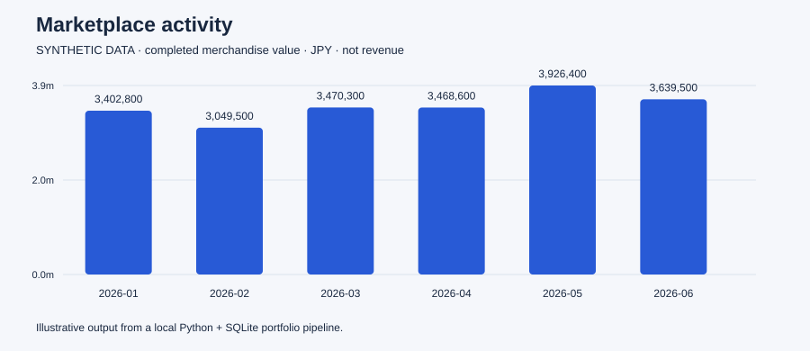

# Pipeline output

**Synthetic data only. These are generated examples, not results about Mercari or a real business.**

| Check / metric | Value |
| --- | ---: |
| Source rows | 2,408 |
| Accepted rows | 2,400 |
| Rejected rows | 8 |
| Completed merchandise value (JPY) | 20,957,100 |
| Buyers with a completed order | 577 |
| Buyers with at least two completed orders | 509 |
| Repeat-buyer share within this observation window | 88.21% |

## Rejection audit

Each rejected row has one primary reason; CSV source lines include the header.

| Reason | Rows |
| --- | ---: |
| duplicate_order_id | 2 |
| invalid_date | 1 |
| invalid_price | 2 |
| invalid_status | 1 |
| missing_required_value | 2 |

## Interpretation and limits

- Completed merchandise value sums final-state completed orders. It excludes cancellations and full refunds; it is **not revenue**.
- Repeat-buyer share describes this finite synthetic observation window. It is **not cohort retention** and depends on observation length.
- There is no intentional business trend in the generator. Month-to-month differences are random variation and calendar-length effects.
- Review `monthly_metrics.csv`, `category_metrics.csv`, and `rejected_rows.csv` for underlying outputs.
